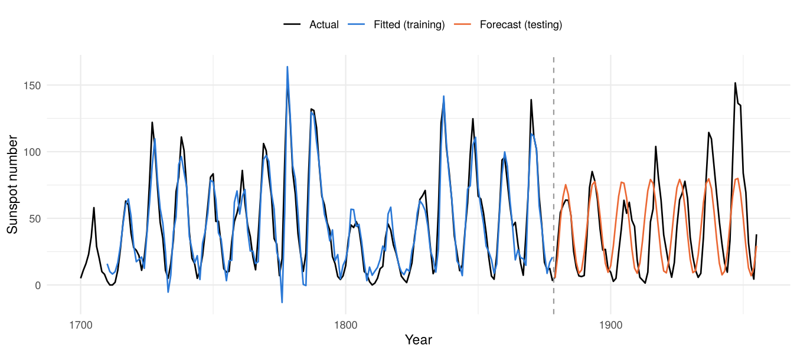

# Bilinear Model

<!-- badges: start -->
[](LICENSE.md)
<!-- badges: end -->

**bilinear** fits *subset bilinear time series models* (Subba Rao & Gabr, 1984)
in R by conditional least squares, which under Gaussian errors is the
conditional maximum likelihood estimator. It provides `print`, `summary`,
`predict`, `coef`, `vcov` methods and the residual diagnostics used in the
original monograph.

As far as I know, no CRAN package currently estimates general subset bilinear
models; this package was written to fill that gap and has been validated
against the published results of Subba Rao & Gabr (1984).

## The model

```math
   X_t + \sum_{k \in K} a_k X_{t-k}
   = \alpha + \sum_{l \in C} c_l\, e_{t-l}
   + \sum_{(i,j) \in B} b_{ij}\, X_{t-i}\, e_{t-j} + e_t ,
   \qquad e_t \sim \text{iid } (0, \sigma^2)
```

- `ar` = set of AR lags $K$ (note the sign convention: $a_1 = -\phi_1$)
- `ma` = set of MA lags $C$
- `bl` = list of pairs $(i, j)$: lag $i$ of $X$ times lag $j$ of $e$

In this README a model is written as **BL(K, C, B)**, for example
`BL([1,2,9], 0, {(2,1), (8,1), (1,3)})`.

## Installation

```r
# install.packages("remotes")
remotes::install_github("zakiabiqu/Bilinear-Model")
```

## Quick start

```r
library(bilinear)

sun <- window(sunspot.year, 1700, 1920)

# Model S of Subba Rao & Gabr (1984):
# BL([1,2,9], 0, {(2,1),(8,1),(1,3),(4,3),(1,6),(2,4),(3,2)})
fit <- bilinear(sun, ar = c(1, 2, 9), gamma = 10,
                bl = list(c(2, 1), c(8, 1), c(1, 3), c(4, 3),
                          c(1, 6), c(2, 4), c(3, 2)))
summary(fit)
```

```
Coefficients:
           Estimate   Std. Error   z value   Pr(>|z|)    
a1     -1.501226881  0.043910295 -34.18849 < 2.22e-16 ***
a2      0.766997793  0.045246758  16.95144 < 2.22e-16 ***
a9     -0.115214943  0.021102867  -5.45968 4.7699e-08 ***
b(2,1) -0.014575162  0.001018191 -14.31477 < 2.22e-16 ***
b(8,1)  0.006312063  0.000957092   6.59505 4.2512e-11 ***
b(1,3) -0.007151641  0.000907755  -7.87838 3.3165e-15 ***
b(4,3)  0.006047304  0.001241959   4.86917 1.1207e-06 ***
b(1,6)  0.003618668  0.000736909   4.91061 9.0796e-07 ***
b(2,4)  0.004333547  0.001162624   3.72738 0.00019348 ***
b(3,2)  0.001781560  0.001487337   1.19782 0.23098759    
alpha   6.885606215  1.484603166   4.63801 3.5178e-06 ***
---
Note: standard errors of b may be underestimated; consider bootstrap.

sigma^2 = 124.328   log-likelihood = -808.21   AIC = 1039.64   NAIC = 4.9272
n = 211 (N = 221, gamma = 10), 11 parameters

Residual diagnostics:
                         Statistic Distribution p-value
Independence W              1.5609       N(0,1) 0.11855
Skewness u1 (G1 = 0.741)    4.2472       N(0,1) < 1e-04
Kurtosis u2 (G2 = 0.981)    2.9092       N(0,1) 0.00362
Normality u1^2 + u2^2      26.5020    Chi-sq(2) < 1e-04
Ljung-Box on e (lag 10)     7.7908    Chi-sq(7) 0.35140

Convergence: yes (17 iterations)
Invertibility: yes
```

### Forecasting

The one-step forecast is exact; for $h \ge 2$ the conditional expectation is
evaluated by Monte Carlo and prediction intervals are empirical quantiles
(forecast distributions of bilinear models are generally asymmetric).

```r
predict(fit, n.ahead = 3, seed = 1)
```

```
    Forecast      SE    Lo 80   Hi 80    Lo 95   Hi 95
h=1  24.5519 11.1502   9.9867 39.1347   1.9921 46.7370
h=2   9.7935 15.6585 -10.4605 29.7332 -20.6578 40.8083
h=3   4.4393 22.7906 -25.1566 32.9683 -40.8924 48.3038
```

Rolling one-step forecasts on new data, with parameters held fixed:

```r
fc <- predict(fit, newx = window(sunspot.year, 1921, 1955))
fc$onestep$mse
#> [1] 123.7711
```

### Plotting with ggplot2

The fitted object holds everything needed for plotting (`fit$x`,
`fit$fitted.values`, `fit$residuals`), so standard `ggplot2` code is enough.
The figure below uses a 70:30 training/testing split of the 1700–1955 sunspot
series (code in [`tools/make-readme-figures.R`](tools/make-readme-figures.R)).

```R
library(ggplot2)

sun <- window(sunspot.year, 1700, 1955)
n_train <- floor(0.7 * length(sun))
train <- window(sun, end = time(sun)[n_train])
test  <- window(sun, start = time(sun)[n_train + 1])

fitS <- bilinear(train, ar = c(1, 2, 9), gamma = 10,
                 bl = list(c(2, 1), c(8, 1), c(1, 3), c(4, 3), c(1, 6), c(2, 4), c(3, 2)))

fc <- predict(fitS, n.ahead = length(test), seed = 123)

df <- rbind(
  data.frame(tahun = as.numeric(time(sun)),   nilai = as.numeric(sun),                jenis = "Aktual"),
  data.frame(tahun = as.numeric(time(train)), nilai = as.numeric(fitS$fitted.values), jenis = "Fitted (training)"),
  data.frame(tahun = as.numeric(time(test)),  nilai = as.numeric(fc$pred),            jenis = "Forecast (testing)")
)
df$jenis <- factor(df$jenis, levels = c("Aktual", "Fitted (training)", "Forecast (testing)"))

ggplot(df, aes(x = tahun, y = nilai, colour = jenis)) +
  geom_line(linewidth = 0.6, na.rm = TRUE) +
  geom_vline(xintercept = max(time(train)) + 0.5, linetype = "dashed", colour = "grey60") +
  scale_colour_manual(values = c("Aktual" = "black", "Fitted (training)" = "#2a78d6",
                                 "Forecast (testing)" = "#eb6834")) +
  labs(x = "Tahun", y = "Bilangan sunspot", colour = NULL) +
  theme_minimal() +
  theme(legend.position = "top")
```



## Validation against Subba Rao & Gabr (1984)

The test suite (`tests/testthat/`) reproduces the published results:

| Series | Model | Quantity | Book | This package |
|---|---|---|---|---|
| Sunspot 1700–1920 | Model S | $\hat\sigma^2$ | 124.33 | 124.328 |
| Sunspot 1700–1920 | Model S | NAIC | 4.927 | 4.9272 |
| Sunspot 1921–1955 | Model S | one-step MSE | 123.77 | 123.771 |
| log₁₀ lynx 1821–1920 | BL([1,2,3,4,9,12], 0, 6 terms) | $\hat\sigma^2$ | 0.0223 | 0.02227 |
| log₁₀ lynx 1821–1920 | same | NAIC | −3.508 | −3.5089 |

The manual Gauss–Newton iterations of the small worked example in the
methodology notes are also reproduced to four decimals.

## Main arguments of `bilinear()`

| Argument | Meaning |
|---|---|
| `x` | numeric vector or `ts` |
| `ar`, `ma` | vectors of AR and MA lags (subset models allowed) |
| `bl` | list of `c(i, j)` pairs for $X_{t-i} e_{t-j}$ |
| `gamma` | recursion starts after observation `gamma` ($e_t = 0$ for $t \le \gamma$); defaults to the maximum lag. Use the **same** `gamma` when comparing models by AIC |
| `intercept` | include $\alpha$ |
| `start` | optional starting values; otherwise OLS-AR start plus staged multi-start |
| `scale` | divides the series before fitting (estimates are reported on the original scale) |
| `trace` | print the iteration history |

See `?bilinear` for the complete list and for the returned components.

## Methodology

A detailed derivation of the estimator — conditional likelihood, recursive
derivatives $\psi_{t,u}$, gradient and Hessian, Gauss–Newton with
step-halving, starting values, invertibility check, parameter tests, residual
diagnostics, forecasting, and worked iterations by hand — is available in two
languages:

- English: [`docs/bilinear_eng.pdf`](docs/bilinear_eng.pdf)
- Indonesian: [`docs/bilinear_idn.pdf`](docs/bilinear_idn.pdf)

## Limitations

- Estimation is **conditional** (pre-sample errors set to zero), not exact ML.
- Standard errors of the bilinear coefficients $b_{ij}$ tend to be
  underestimated in finite samples (simulated 95% coverage ≈ 91.5%); a
  bootstrap is safer for inference on $b_{ij}$.
- The likelihood surface can be multimodal. The default multi-start keeps the
  solution with the smallest residual sum of squares **among invertible
  fits**, and the order of the terms in `bl` affects the staged starting
  values.
- There is no automatic subset selection; candidate models must be specified
  and compared (e.g. by NAIC) by the user.

## References

Subba Rao, T. and Gabr, M. M. (1984). *An Introduction to Bispectral Analysis
and Bilinear Time Series Models*. Lecture Notes in Statistics 24. Springer.
<https://doi.org/10.1007/978-1-4684-6318-7>

Gabr, M. M. and Subba Rao, T. (1981). The estimation and prediction of subset
bilinear time series models with applications. *Journal of Time Series
Analysis*, 2(3), 155–171.

## Citation

```r
citation("bilinear")
```

## License

MIT © Zaki Abiyu Aqilah
